# SOC Automation Pipeline

**Wazuh → n8n → threat intel → explainable scoring → Telegram approval → verified containment**

A home-lab version of how a SOC automates triage while keeping a human in charge of every response. Wazuh sends selected alerts to n8n. n8n checks the attacker's IP on AbuseIPDB, VirusTotal and AlienVault OTX, scores the alert with an explainable points table, and reports it on Telegram with the reasons and a proposed action. Containment (blocking an IP for one hour, or disabling an Active Directory account) happens only after an analyst approves, and is reported as done only when the endpoint itself confirms it.

| | |
|---|---|
| **Alert → containment, playbook A** (SSH brute force → block the IP) | **2 min 08 s by hand → 25 s with the pipeline** (medians) |
| **Alert → containment, playbook B** (privileged AD group changed → disable the account) | **1 min 05 s by hand → 26 s with the pipeline**, including a typed confirmation |
| **Machine time** | about 3 s before the analyst sees the alert, 1–3 s after the approval; the rest is the human decision |
| **Live tests** | approve, reject, double click, late click, timeouts, wrong typed name, protected accounts, undo, block expiry, a real outage: all behave safely |
| **Guardrails** | allowlist and protected accounts checked twice, least-privilege API user, verified TLS, every action reversible and proven, full audit trail in Wazuh |

Built over five milestones. Everything is free to run (open-source tools and free API tiers).

---

## Architecture

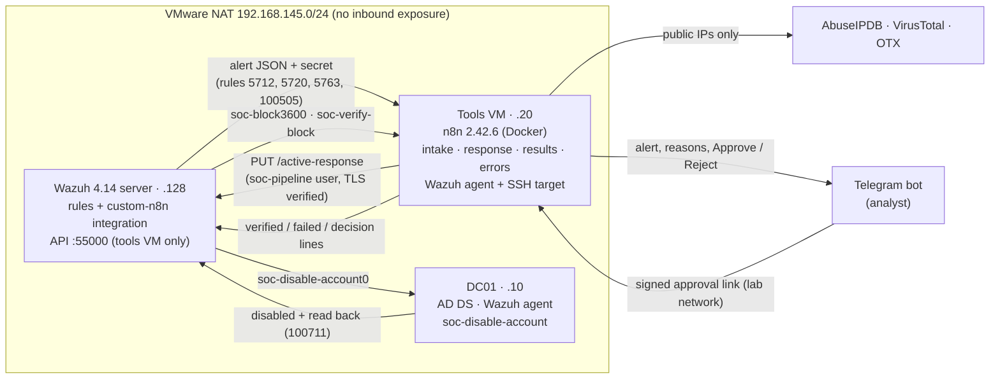

| Playbook | Trigger | Proposed action | Verified by |
|---|---|---|---|
| **A** | SSH brute force (Wazuh rules 5712, 5720, 5763) | Block the source IP on the agent for 1 hour (`firewall-drop`, expiry enforced by the agent) | `iptables -C` on the agent → rule 100701 |
| **B** | A privileged AD group changed by a non-approved account (rule 100505, from my AD Identity Detection Lab project) | Disable that account (after a typed confirmation) | DC01 reads the account back from AD → rule 100711 |

## Screenshots

Attacker IPs are masked (first two numbers kept).

**Playbook A: SSH brute force → block the IP for 1 hour**

  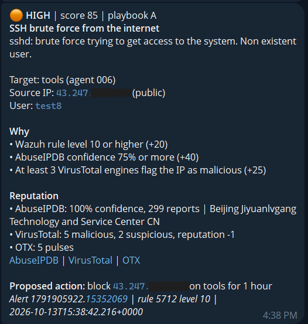
  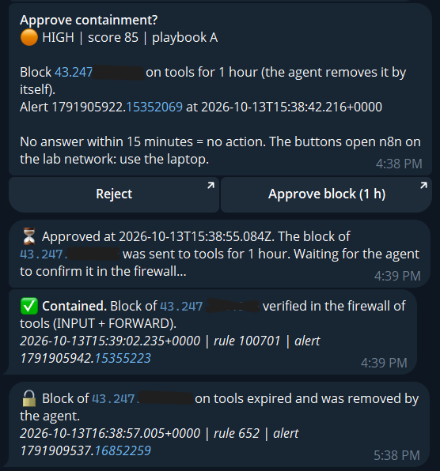

The alert with its reasons and reputation (left); one tap on Approve, then "Contained" only once the agent has verified the firewall rule, and the block removing itself an hour later (right).

**Playbook B: privileged group changed → disable the account, with a typed confirmation**

  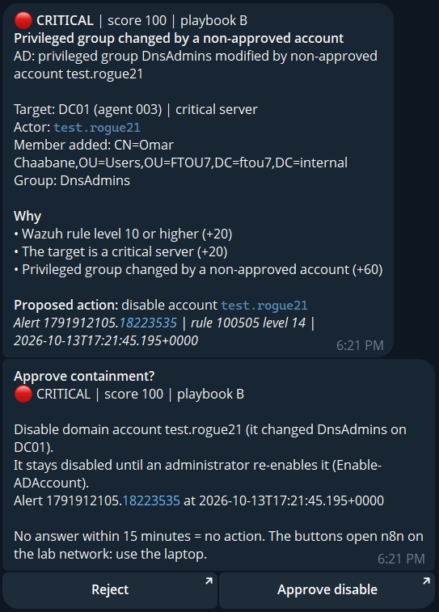
  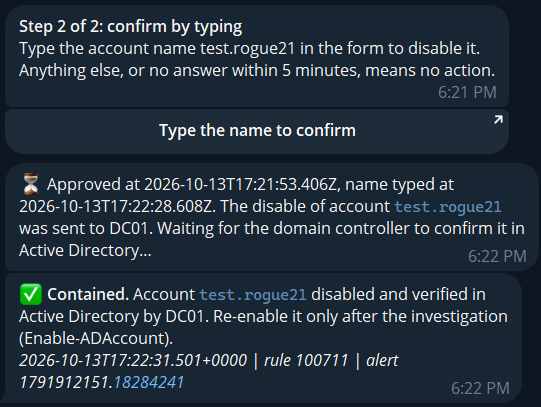

  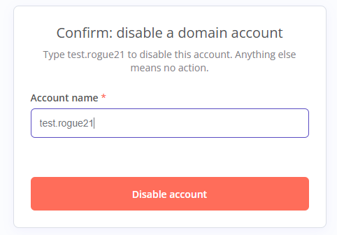

Approve is only step 1: the account is disabled after its exact name is typed in the form, and "Contained" comes from DC01 reading the account back from Active Directory.

**A clean IP: no action offered**

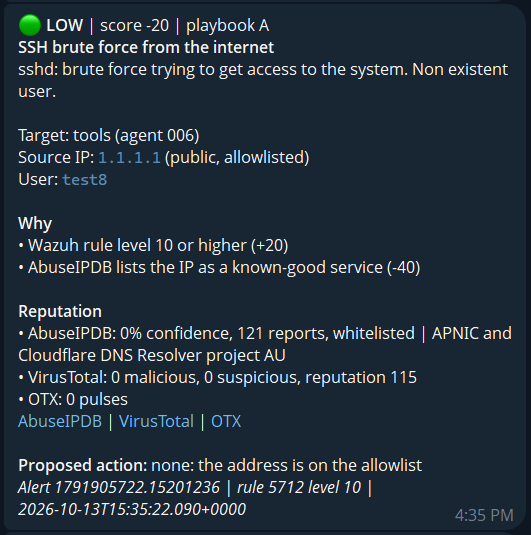

**The whole case in the SIEM:** detection (5712), scoring (100721), block (651), decision (100722) and verification (100701), 20 seconds from alert to verified block.

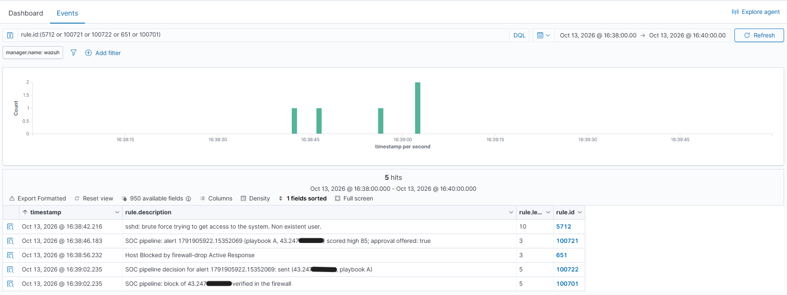

**Failures are loud:** a forced Telegram outage raised rule 100720 (level 12) in Wazuh. The Telegram notice below got through on a retry once the test lifted the outage; Wazuh does not depend on it.

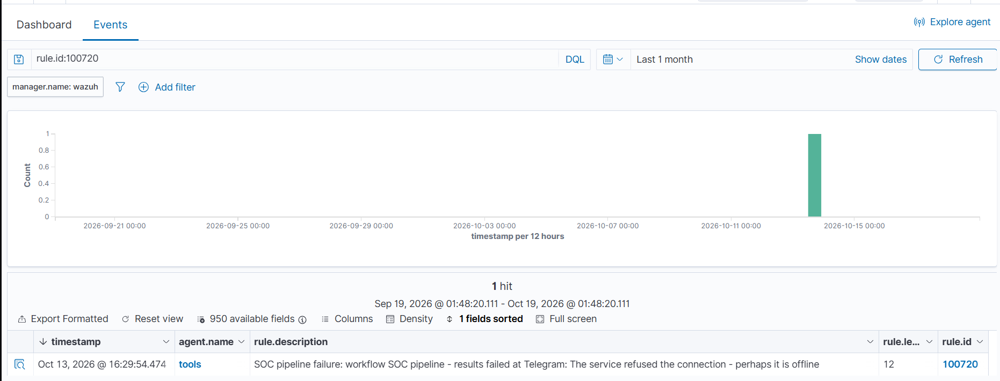

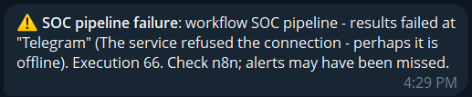

**The n8n workflows:** intake (validate, enrich, score, notify) and response (approval, typed confirmation, Wazuh API calls, verification, decision log).

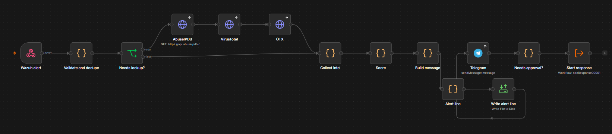

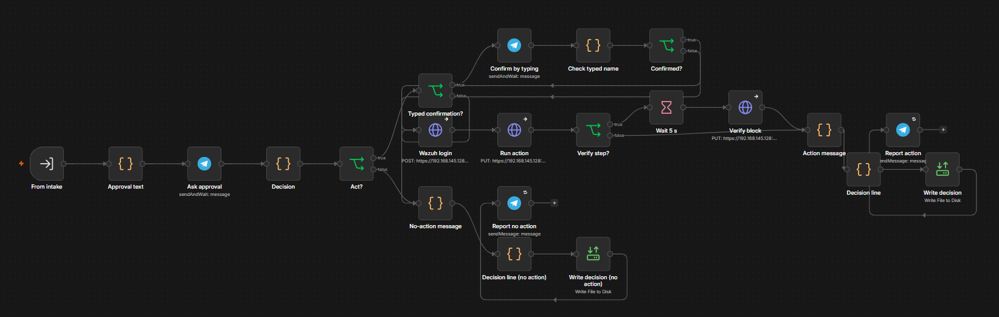

## How it works

1. **Wazuh** raises an alert. A custom integration (`wazuh/integrations/custom-n8n.py`) forwards only the playbook rules to n8n.
2. **n8n webhook** accepts it only from the Wazuh server's IP **and** with the shared secret.
3. **Validate and dedupe:** IPs and account names are used only if they pass strict checks (alerts carry attacker-controlled text). The same IP or account within 60 minutes produces one message.
4. **Enrich:** public IPs go to AbuseIPDB, VirusTotal and OTX, cached for 24 h. Private and reserved addresses never leave the lab.
5. **Score:** an explainable points table → low / medium / high / critical, with every reason listed (see Scoring).
6. **Telegram:** severity, reasons, reputation with links, and the proposed action. Low severity arrives silently.
7. **Approve / Reject:** high and critical alerts get a second message with two buttons: n8n's signed links, which cannot be forged and open n8n on the lab network. No answer within 15 minutes means no action.
8. **Typed confirmation (playbook B only):** after "Approve disable", a form asks for the account name. Only the exact name unlocks the action; anything else, or no answer within 5 minutes, means no action. Reject stays one tap, and playbook A stays one tap: friction where the damage is bigger.
9. **Act:** a separate response workflow re-checks every guardrail and calls the Wazuh API as `soc-pipeline`:
   - **A:** `soc-block3600`, Wazuh's stock `firewall-drop` with a 1-hour expiry that the agent enforces by itself, even if n8n is down.
   - **B:** `soc-disable-account0`, a PowerShell script on DC01 that checks the account again (built-in accounts, protected names and **any tier-0 group member** are refused), disables it and reads it back from AD.
10. **Verify:** for A, a read-only check of the firewall 5 seconds later; for B, the DC's read-back. "✅ Contained" is sent only on that proof; IP block expiry (rule 652) is reported too.
11. **Record:** every scored alert and every decision is written to a log Wazuh reads (rules 100721–100723); any workflow failure raises rule 100720 at level 12.

## Safety guardrails

- **Webhook:** accepted only with the shared secret **and** from the Wazuh server's IP.
- **Untrusted alert data:** IPs and account names must pass strict checks; nothing from an alert reaches a shell; every field is escaped in Telegram messages; a typed confirmation only unlocks the action and is never used in it.
- **Privacy:** only public IPs leave the lab; private and reserved addresses are never looked up. Real attacker IPs are masked in this repository.
- **Never blocked:** non-public addresses and an allowlist (lab network, public DNS resolvers), checked at intake **and again after approval**.
- **Least privilege:** the Wazuh API user `soc-pipeline` may only run active responses, and only on the two agents that need them (tools VM, DC01); everything else is refused (403) or returns nothing. The API certificate is verified (no "ignore TLS errors"), and port 55000 is open to the tools VM only. The admin password never left the analyst's hands; the generated one was piped into n8n and shredded.
- **Defense in depth for accounts:** protected names are refused in n8n, then again on DC01, which also refuses built-in accounts and tier-0 group members (14/14 dry-run cases, including a quote-injection attempt and a computer account).
- **Reversible and proven:** IP blocks expire after an hour on their own; every action is confirmed on the endpoint before the pipeline says "contained". A disabled account is re-enabled only by an administrator after the investigation, and AD's own events show who did what (4725 by the DC for the pipeline, 4722 by the admin for the undo).
- **Audit trail in the SIEM:** every scored alert (rule 100721) and every outcome (rule 100722: sent / rejected / no answer / refused / typed name did not match, with click times and the command; 100723 at level 10 if an approved action failed) is written **before** the Telegram message to a local log that Wazuh reads. One search in the dashboard shows a case from alert to containment.
- **Failures are loud:** any workflow failure is written by an n8n error workflow to the same local log → rule 100720 (level 12), with no network needed. Telegram steps retry 3 times.
- **No silent automation:** a pre-existing automatic block on rule 100101 (no approval, no expiry) was disabled; the history showed it had once blocked one of the lab's own workstations, permanently. The rule still detects.

## Threat model

The pipeline can block IPs and disable accounts, so it is a target in its own right.

| Threat | What an attacker could try | What stops it | What remains |
|---|---|---|---|
| **Forged or crafted logs** | Write log lines that make a legitimate IP or account look malicious, or inject text into messages | Every action needs a human approval; allowlist and protected accounts checked twice; strict parsing; escaping | A careless analyst could approve a forged case: the message shows the reasons and links so it can be checked |
| **Fake alerts to the webhook** | POST alerts directly to n8n | Shared secret **and** source-IP allowlist (the right secret from another IP is refused) | The secret is visible in n8n's execution history for 14 days (see known limits) |
| **Forged approvals** | Approve a pending action without the analyst | n8n's signed resume links; reachable only from the lab network; a second click or a late click does nothing | Anyone with access to the analyst's Telegram on the laptop can approve |
| **Abuse of the API user** | Use `soc-pipeline` to run other commands or reach other agents | RBAC: active responses only, on agents 006 and 003 only; port 55000 open to the tools VM only; DC01 refuses protected accounts itself | A compromised tools VM could run active responses on those two agents |
| **Taking over n8n** | Steal credentials, change workflows | n8n on the lab network only, owner login with two-factor authentication, credentials encrypted, community packages off, pinned image | Plain HTTP inside the NAT network (see known limits) |
| **Silencing the pipeline** | Break Telegram, DNS or a workflow so alerts vanish | Retries, the error workflow → Wazuh rule 100720 (tested with a forced outage) | If n8n itself is down, Wazuh still has the original alerts but nobody is paged |

## Scoring

The table was written by the analyst (Fathia) and lives in [`scoring/score.js`](scoring/score.js). Every fact it can use is documented in [`scoring/FACTS.md`](scoring/FACTS.md), and 14 test cases in [`tests/scoring/fixtures.json`](tests/scoring/fixtures.json) lock its behaviour (`scripts/Test-Scoring.ps1`).

| Rule | Points | Why |
|---|---|---|
| R1 Wazuh level 10+ | +20 | Wazuh already judged it serious (a baseline: every playbook trigger is level 10+) |
| R2 Critical target (DC01) | +20 | Same attack, bigger damage |
| R3 AbuseIPDB confidence 75%+ | +40 | Strongest signal, many reporters |
| R4 AbuseIPDB confidence 25–74% | +20 | Suspicious, not certain |
| R5 VirusTotal 3+ engines malicious | +25 | Several engines agree |
| R6 AbuseIPDB whitelisted | −40 | Known-good service, not an attacker |
| R7 A lookup failed | +10 | Unknown is never "safer" |
| R8 Playbook B | +60 | A privileged group changed by a non-approved account is serious by itself |

Severity: 30+ medium, 60+ high, 90+ critical. High and critical are offered Approve / Reject.

**Design choices**
- **Playbook B is always critical** (R1 + R2 + R8 = 100): a policy rule on the most important server, not a reputation judgement, so a human always decides.
- **AbuseIPDB at 75% or more reaches high on its own** (60 points). Since every action needs approval, a score that is too high costs one tap on Reject, while one that is too low costs slower containment.
- **OTX is shown but not scored** until bad and clean IPs have been compared on a larger sample.
- **A failed lookup adds only +10**, so it can never reach high on its own.

## Before / after

The same two attacks handled **by hand** (pipeline switched off; the analyst watches the Wazuh dashboard, checks the IP on the three sites or the account in AD, and runs the block or the disable herself) and **with the pipeline** (the analyst only reacts on Telegram). Each attack started at a hidden random moment; T0 (the Wazuh alert) and T3 (containment in place, logged by Wazuh: rule 651 for the block, event 4725 for the account) are Wazuh timestamps in both modes. Method and checklist: [`docs/manual-baseline.md`](docs/manual-baseline.md); every run: [`metrics/baseline-runs.csv`](metrics/baseline-runs.csv); table built by [`metrics/summarize.py`](metrics/summarize.py).

| Playbook | Mode | Alert → containment, median (range) | Runs |
|---|---|---|---|
| A: SSH brute force → block the IP | by hand | **2 min 08 s** (1 min 50 s – 2 min 25 s) | 5 (+1 "no action") |
| A | pipeline | **25 s** (10 s – 25 s) | 3 |
| B: privileged group change → disable the account | by hand | **1 min 05 s** (48 s – 1 min 49 s) | 3 |
| B | pipeline, with the typed confirmation | **26 s** (23 s – 31 s) | 3 |

- **Where the time goes:** by hand, a median 1 min 27 s on lookups and scoring (A) and about 24 s typing the block command. With the pipeline, the machine needs about 3 s before the human and 1–3 s after: almost all of the remaining time is the analyst's decision (A: ~21 s; B: ~19 s including about 8 s to type the account name).
- **Decisions agree:** in the one manual run where the analyst chose "no action" (AbuseIPDB 4%, 2 VirusTotal engines), the scoring table gives the same answer.
- **One alert was lost** during the automated runs: a brief DNS failure made the Telegram call fail. It led to the retries and the failure alert (rule 100720), tested afterwards with a forced outage.

**Read with care:** small samples (3 to 5 runs per group); one analyst who knew an attack was coming within two minutes and was not working a queue, so both manual and approval times are **optimistic**; the manual times still improved during the session (learning effect). The real-world gap is likely larger, because a human watching a dashboard among other alerts notices later than a push notification.

## Test results

**Intake and scoring**

| Test | Result |
|---|---|
| 3 IPs from the blocklist.de SSH list (211.253.x.x KR, 203.128.x.x PK, 200.73.x.x AR) | All **HIGH, 85**: AbuseIPDB 100%, VirusTotal 7–12 malicious; block proposed |
| 1.1.1.1 (clean, allowlisted) | **LOW, −20**: whitelisted by AbuseIPDB; "no action: allowlisted" |
| The same IP again within 60 minutes | Suppressed: no lookups, no message |
| Reserved address 203.0.113.52 | No lookups ("never leaves the lab"); no action |
| Webhook without the secret, with a wrong one, or with the right one from another IP | Rejected (403) |

**Playbook A (IP block)**

| Test | Result |
|---|---|
| **Approve** | Block active on the agent **under 1 s after the click**, verified by the agent ~6 s after |
| Approve clicked a second time | "Already handled": still exactly one block |
| The approved block, one hour later | Removed by the agent itself after 3,601 s; Wazuh rule 652 → "🔓 expired" on Telegram |
| **Reject** | "🚫 Rejected": no Wazuh API call, no firewall rule |
| **No answer** for 15 minutes, then a late click | "⌛ No answer: no action"; the late click says "No action required" and does nothing |

**Playbook B (account disable)** — temporary accounts given a delegated right on DnsAdmins, then misusing it; all removed afterwards and DnsAdmins restored

| Test | Result |
|---|---|
| **Approve + typed name** | Disabled and verified **3 s after the name was typed**; nothing sent at the first click |
| Wrong name typed | "✋ The typed name did not match: no action"; account untouched |
| **Reject** | "🚫 Rejected": no request, account untouched |
| Protected actor (`svc_*`) | "none: protected account": no buttons, response never started |
| No answer for 15 minutes | "⌛ No answer: no action" |
| Undo after a mistaken approval | Re-enabled by an administrator; AD shows 4725 (by the DC) then 4722 (by the admin) |

**Pipeline health**

| Test | Result |
|---|---|
| Telegram blocked on purpose | Workflow failure → rule 100720 (level 12) in Wazuh 10 s later; the block removed automatically |
| Decision log | "Alert scored" (100721) and "decision: sent" (100722) next to the verification (100701) in Wazuh |

Attacks are **replayed log lines** (playbook A) or a scripted misuse of a delegated right (playbook B), not real traffic: the lab is never exposed to the internet.

## Known limits

**Accepted scoring limits**
- **VirusTotal alone can never reach high** (5 engines and nothing else scores 45, medium). *Fix later:* a stronger VirusTotal tier (for example +40 at 10 or more engines) once more tests show how rarely clean IPs reach that count.
- **A known-bad IP during an AbuseIPDB outage scores medium (55), so no buttons are offered.** *Fix later:* retry AbuseIPDB once before scoring, or a fallback rule that gives VirusTotal more weight when AbuseIPDB is unavailable.

**Response**
- Playbook B disables the actor but does not undo its change: the member it added stays in the privileged group until an administrator removes it. *Fix later:* a "remove the added member" action under the same approval.
- Tier-0 accounts are never disabled automatically, by design: a compromised admin account is handled by hand.
- Containment waits for a human: when nobody answers, nothing happens (this happened twice in testing). *Fix later:* escalate to a second approver or an on-call channel after a few minutes.
- Approvals work only from a device on the lab network, because the buttons open n8n there. *Fix later:* reach n8n through a VPN such as WireGuard, behind TLS, to approve from a phone.

**Platform**
- If n8n itself is down, nobody is paged (Wazuh still has the original alerts). *Fix later:* a Wazuh-side check that the pipeline log keeps receiving lines.
- n8n runs over plain HTTP inside the lab's NAT network. *Fix later:* a TLS reverse proxy, secure cookies back on.
- n8n keeps webhook request headers, including the shared secret, in its execution history (pruned after 14 days). *Fix later:* Wazuh signs each request with an HMAC of the body.
- Two alerts for the same IP arriving within milliseconds can both pass dedupe. *Fix later:* one production execution at a time (`N8N_CONCURRENCY_PRODUCTION_LIMIT=1`).
- Telegram's API occasionally answers slowly (once 33 s instead of ~0.35 s), which delays the alert.

**Coverage**
- OTX pulses are not scored yet (so far: bad IPs had 2–50 pulses, the one clean IP had 0).
- IPv6 sources are reported but neither looked up nor blocked.
- File hashes are not looked up, because neither playbook has a file indicator. *Fix later:* a notify-only playbook on Wazuh file-integrity alerts.

## Run it yourself

Prerequisites: a Wazuh 4.14 server with agents, an Ubuntu VM with Docker for n8n, a Telegram bot, free API keys for AbuseIPDB, VirusTotal and OTX, and (for playbook B) an AD domain controller with a Wazuh agent. In order:

1. Tools VM: `tools-vm/setup_base.sh`, then `tools-vm/deploy_n8n.sh` (n8n pinned by digest); create the n8n owner account and the credentials (`Telegram bot`, `VirusTotal key`, `AbuseIPDB key`, `OTX key`).
2. Wazuh server: `wazuh/new_api_cert.sh`, then `wazuh/deploy_manager.sh` (integration, rules, commands, firewall); pipe the webhook secret into n8n with `tools-vm/install_webhook_secret.sh`.
3. API user: `wazuh/create_api_user.py --agents <ids>` (asks for the admin password), then `tools-vm/install_api_credential.sh`.
4. Agents: `wazuh/active-response/install_linux.sh` (Linux) and `Install-SocResponse.ps1` (DC); add the pipeline log to the tools agent with `tools-vm/add_pipeline_log_to_agent.sh`.
5. Workflows: `scripts/Deploy-Workflow.ps1` for `soc-errors`, `soc-results`, then `soc-response` (it re-publishes the intake).
6. Settings that are not secret (Telegram chat ID) go in `/opt/soc-pipeline/pipeline.conf`; the scoring table in `scoring/score.js`.

## Repository layout

| Path | Contents |
|---|---|
| `wazuh/` | Integration script, pipeline rules (100700–100723), active-response scripts (Linux and Windows), installers, the API user script and its check |
| `tools-vm/` | n8n Docker Compose file, VM setup, workflow importer, mode switch, execution viewer, credential installers |
| `n8n/workflows/`, `n8n/code/` | Workflow templates (intake, response, results, errors); Code-node logic as plain JavaScript files |
| `scoring/` | Scoring table and the list of facts it can use |
| `tests/` | Scoring tests, the SSH replay, the playbook B scenario, the baseline firing helpers, the failure-alert test |
| `metrics/` | Every baseline run and the script that builds the before/after table |
| `docs/` | Manual baseline method and screenshots (`docs/screenshots/`) |
| `scripts/` | Deploy and test helpers run from the Windows host |

## Credits and licences

- [Wazuh](https://wazuh.com) (GPLv2): SIEM, rules and the stock `firewall-drop` response. The integration reuses Wazuh's own Python launcher on the server; it is copied there by the installer, not stored in this repository.
- [n8n](https://n8n.io) (Sustainable Use License): self-hosted for this lab; no n8n code is included here.
- Threat intelligence: [AbuseIPDB](https://www.abuseipdb.com), [VirusTotal](https://www.virustotal.com) (free public API, non-commercial use), [AlienVault OTX](https://otx.alienvault.com). Test IPs came from the [blocklist.de](https://www.blocklist.de) SSH list; the list itself is not in this repository.

## Lab

VMware NAT network 192.168.145.0/24: Wazuh 4.14 server (.128), an Ubuntu "tools" VM running n8n 2.42.6 in Docker (.20), and the domain controller DC01 (.10) from the AD lab. Nothing is exposed to the internet.
